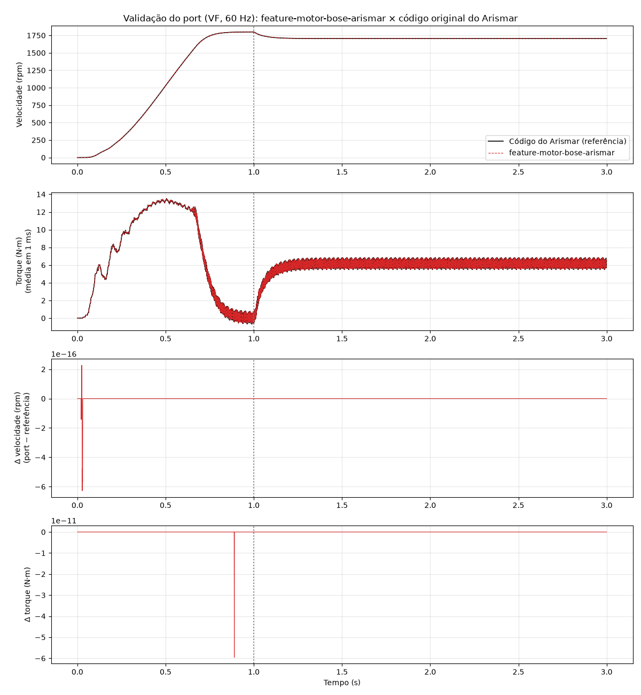
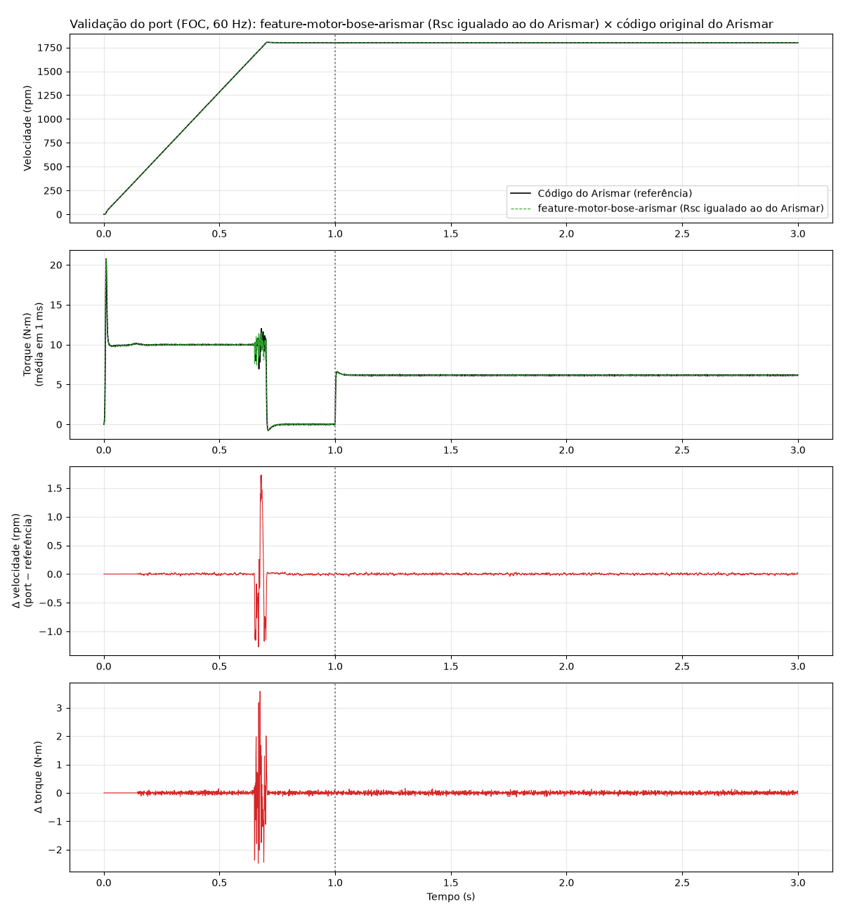
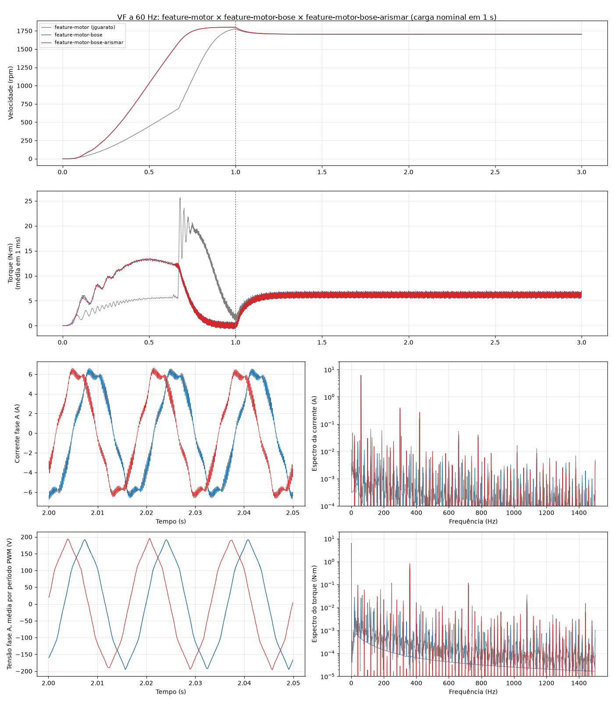
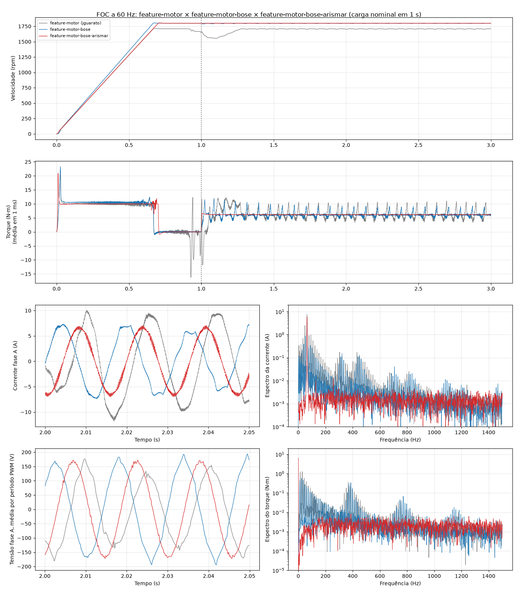

# Relatório comparativo: feature-motor, feature-motor-bose e feature-motor-bose-arismar

Acionamentos V/f e FOC do motor do tutorial a 60 Hz. Data: 21/11/2026.

## 1. Resumo

- **O que foi feito.** A nova branch local `feature-motor-bose-arismar` parte da `feature-motor` do jguarato (commit `0ec7dad5`) e leva para o ROSS as modificações dos arquivos `Codigos_MIT-SVPWM_Final` (V/f e FOC, versão 2). São 2 commits, 5 arquivos, +651/−182 linhas, com 14 funções de teste novas (32 casos) e 2 testes existentes ajustados (seção 8). Nada foi enviado ao GitHub.
- **O port é fiel.** No V/f, a tensão sintetizada, a velocidade e o torque do ROSS coincidem com o código do Arismar em **todas as 1,5 milhão de amostras**: a diferença máxima é 6e-16 rpm e 6e-11 N·m. No FOC, a corrente coincide (diferença menor que 1e-5 A) nas primeiras 72,718 amostras (0,145 s) e as grandezas de regime são equivalentes (corrente fundamental de 6,610 A contra 6,610 A, mesma partida de 37,7 A, com a resistência de curto-circuito igualada). Depois disso as trajetórias do FOC se separam lentamente, como é comum em PWM (seção 4).
- **V/f.** As três versões chegam ao mesmo regime (1704 a 1705 rpm com carga nominal, THD de corrente entre 7,4% e 8,0%). A diferença relevante é a partida: no jguarato o ângulo é `f·t` e a aceleração é mais lenta, com pico de corrente de 33,3 A contra 14,9 A nas outras duas. Bose e arismar são praticamente iguais; a diferença entre eles é pequena (THD 7,37% e 7,46%).
- **FOC.** É onde as versões mais diferem. O arismar tem THD de corrente de 0,31% e ripple de torque de 1,9%, contra 3,35% e 13,4% no bose e 2,06% e 25,1% no jguarato. O jguarato também limita a referência a 1710 rpm; as outras duas chegam a 1800 rpm.
- **A corrente de magnetização é decisiva.** No arismar, trocar `ids_ref = 3,2 A` pelo valor calculado (3,78 A) leva o ripple de torque de 1,9% para 20,1% e o THD de 0,31% para 3,70%. A medição do índice de modulação mostra o motivo: com 3,78 A, o controle fica saturado no limite de seis passos em 42% dos períodos; com 3,2 A, em nenhum.
- **Passo de integração.** O projeto com retenção por período reduz a dependência do passo no V/f e evita os picos de torque em vazio do FOC mesmo com 20 amostras por período. Mas a qualidade do FOC (THD) só se estabiliza com cerca de 100 amostras (seção 6).

## 2. Versões comparadas

| Versão | Origem | Commit | Conteúdo |
|---|---|---|---|
| feature-motor (jguarato) | Repositório do jguarato | `0ec7dad5` | Modelo do motor, V/f e FOC originais |
| feature-motor-bose | Minha branch local, a partir da feature-motor, com o `main` do petrobras/ross incorporado | `b9198c83` | Sobremodulação de Bose, opções dos inversores (`inverter_options`), correção do ângulo do V/f, THD, tutorial |
| feature-motor-bose-arismar | Nova branch local, a partir da feature-motor | `dfe48e4d` | Port dos arquivos do Arismar: modulação com retenção por período, V/f e FOC por período |

O código original do Arismar (pasta `Codigos_MIT-SVPWM_Final`) foi usado como referência independente para validar o port.

## 3. Como foram feitos os testes

Todos os casos usam o motor de `motor_example()` (1,5 cv, 127 V de fase, 4 pólos, 1710 rpm, Rs = 2,5 Ω, Rr = 1,8 Ω, Xs = Xr = 1,3 Ω, Xm = 43,08 Ω, J = 0,0372 kg·m²), barramento CC de 296,96 V, chaveamento de 5 kHz e passo de integração de 2e-6 s (100 amostras por período de chaveamento). A simulação dura 3 s, com referência de 60 Hz (rampa de 0,6667 s), partida em vazio e torque de carga de 6,16 N·m aplicado em 1 s. As grandezas de regime são medidas entre 2 s e 3 s.

- O THD é o da função `total_harmonic_distortion` (harmônicos de 2 a 50, janela de Hanning, frequência fundamental estimada do sinal), aplicado à corrente da fase A e à tensão da fase A.
- Opções por versão: jguarato com os padrões (a referência do FOC é limitada a 1710 rpm); bose com os padrões no V/f e `frequency_max = 60 Hz` no FOC, para que a referência seja a velocidade síncrona de 1800 rpm, como no Arismar; arismar com os padrões no V/f e `ids_ref = 3,2 A` no FOC (valor de `main_foc_v2.py`), mais uma variante com o `ids_ref` calculado.
- O torque de carga de 6,16 N·m é o valor usado nos programas do Arismar (o torque nominal calculado é 6,161 N·m).
- Scripts, execuções e métricas: `investigacao/versao_arismar/`.

## 4. Validação do port contra o código do Arismar

**V/f.** Para a mesma entrada, as duas implementações produzem os mesmos resultados em todas as 1,500,000 amostras: a tensão da fase A coincide (diferença menor que 1 mV), a velocidade difere em até 6e-16 rpm e o torque em até 6e-11 N·m. Isso valida, de uma só vez, a retenção das razões cíclicas, a portadora, a sobremodulação, a integração do ângulo e o tratamento da resistência de curto-circuito (zerada no V/f, como no código do Arismar).

**FOC.** O laço fechado é sensível: uma diferença de arredondamento é amplificada pelas decisões do PWM e as trajetórias se separam com o tempo. Com a resistência de curto-circuito da rede igualada à do código do Arismar, a corrente coincide nas primeiras 72,718 amostras. Depois disso, as diferenças ficam concentradas no fim da rampa de velocidade (0,65 s a 0,72 s), onde o controle passa pela saturação; em regime, a diferença média em blocos de 1 ms é de 0,12 rpm e 0,19 N·m (rms), e as grandezas de regime coincidem (tabela da seção 5). Com a resistência de curto-circuito padrão do ROSS, a diferença média em blocos é de 0,09 rpm e 0,18 N·m.

Observação: a resistência de curto-circuito da rede no ROSS (0,0037 Ω) é um terço da do código do Arismar (0,0110 Ω), porque o ROSS usa a tensão de fase (`voltage_net = 127 V`) na impedância de curto-circuito e o código do Arismar usa a de linha. Esse ponto já existia na feature-motor e não foi alterado; o efeito é de cerca de 0,3% sobre a resistência do estator.

## 5. Resultados a 60 Hz

### 5.1 V/f

| Versão | f1 (Hz) | I1 (A) | THD i (%) | THD v (%) | Vel. (rpm) | Ripple (%) | Pico partida (A) | t95 (s) |
|---|---|---|---|---|---|---|---|---|
| Código original do Arismar | 60,00 | 6,19 | 7,46 | 4,04 | 1704,9 | 9,5 | 14,9 | 0,68 |
| feature-motor (jguarato) | 60,00 | 6,20 | 8,01 | 4,37 | 1704,2 | 10,0 | 33,3 | 0,88 |
| feature-motor-bose | 60,00 | 6,20 | 7,37 | 3,99 | 1704,8 | 9,2 | 14,8 | 0,68 |
| feature-motor-bose-arismar | 60,00 | 6,19 | 7,46 | 4,04 | 1704,9 | 9,5 | 14,9 | 0,68 |

f1: frequência do estator; I1: corrente fundamental (pico); THD i e THD v: distorção harmônica da corrente e da tensão da fase A; Vel.: velocidade final com carga; Ripple: desvio padrão do torque dividido pela média; Pico partida: maior corrente de fase até 1 s; t95: tempo até 95% da velocidade final.

- O arismar reproduz exatamente o código original do Arismar (primeira e última linhas iguais). Na figura, a defasagem entre as correntes e as tensões do bose e do arismar é a fase inicial da referência de tensão (o arismar parte de 0, como o código original; o bose parte do ângulo do fluxo), não uma diferença de frequência.
- O jguarato acelera mais devagar e passa mais tempo com torque baixo até 1 s; o pico de corrente na partida é mais que o dobro (33,3 A contra 14,9 A). Isso decorre do ângulo `θ = f·t` durante a rampa, que aplica a frequência final desde o início.
- Bose e arismar têm a mesma partida e o mesmo regime. O THD da corrente é de aproximadamente 7,4% a 7,5%, vindo da sobremodulação: o V/f nominal pede um índice de modulação de cerca de 0,95. A diferença entre os dois (7,37% contra 7,46%) é a de recalcular o duty a cada passo contra retê-lo por período.
- A sobremodulação de Bose das duas implementações aplica os mesmos vetores de tensão: a diferença máxima é de 1e-4 V para tensões de cerca de 180 V (índices de modulação de 0,8 a 1,1). São duas implementações independentes (tabelas diferentes), o que as valida mutuamente.

### 5.2 FOC

| Versão | f1 (Hz) | I1 (A) | THD i (%) | THD v (%) | Vel. (rpm) | Ripple (%) | Pico partida (A) | t95 (s) |
|---|---|---|---|---|---|---|---|---|
| Código original do Arismar (ids_ref = 3,2 A) | 64,40 | 6,61 | 0,29 | 0,38 | 1800,0 | 1,9 | 37,7 | 0,67 |
| feature-motor (jguarato) | 63,75 | 8,02 | 2,06 | 1,95 | 1707,6 | 25,1 | 26,0 | 0,63 |
| feature-motor-bose (referência síncrona) | 64,35 | 6,64 | 3,35 | 2,44 | 1799,1 | 13,4 | 19,3 | 0,63 |
| feature-motor-bose-arismar (ids_ref = 3,2 A) | 64,40 | 6,61 | 0,31 | 0,43 | 1800,0 | 1,9 | 38,0 | 0,67 |
| feature-motor-bose-arismar (ids_ref calculado, 3,78 A) | 64,67 | 6,80 | 3,70 | 5,08 | 1798,9 | 20,1 | 37,1 | 0,67 |

f1: frequência do estator; I1: corrente fundamental (pico); THD i e THD v: distorção harmônica da corrente e da tensão da fase A; Vel.: velocidade final com carga; Ripple: desvio padrão do torque dividido pela média; Pico partida: maior corrente de fase até 1 s; t95: tempo até 95% da velocidade final.

Torque eletromagnético em vazio (0,85 s a 1 s, depois da rampa), em N·m:

| Versão | Mínimo a máximo |
|---|---|
| jguarato | -16,28 a 12,33 |
| bose | -0,21 a 0,27 |
| arismar (ids_ref = 3,2 A) | -0,07 a 0,08 |
| arismar (ids_ref calculado) | -0,10 a 0,10 |

- **Referência de velocidade.** O jguarato limita a referência à velocidade nominal (1710 rpm). O bose e o arismar chegam à velocidade síncrona de 1800 rpm. É uma mudança de comportamento: com 60 Hz, o FOC passa a regular 1800 rpm em vez de 1710 rpm.
- **Qualidade da corrente e do torque.** O arismar com `ids_ref = 3,2 A` tem o menor THD de corrente (0,31%) e o menor ripple de torque (1,9%). O bose tem THD de 3,35% e ripple de 13,4%, com oscilações de torque de baixa frequência sob carga (visíveis na figura). O jguarato tem os picos de torque em vazio e o ripple de 25,1%.
- **Partida.** O pico de corrente na partida é de 26,0 A no jguarato, 19,3 A no bose e 38,0 A no arismar. O arismar não limita a corrente de eixo q (o jguarato e o bose a limitam a 3 vezes a corrente nominal), e é a versão com o maior pico de corrente na partida.

### 5.3 Efeito da corrente de magnetização (arismar)

Com o `ids_ref` calculado do ponto nominal (3,78 A), o FOC do arismar degrada: THD de corrente de 3,70% e ripple de torque de 20,1%, contra 0,31% e 1,9% com 3,2 A. O índice de modulação do controle em regime (2 s a 3 s) explica a diferença:

| `ids_ref` | Índice de modulação médio | Máximo | Períodos em sobremodulação | Períodos saturados em seis passos |
|---|---|---|---|---|
| 3,2 A | 0,975 | 1,054 | 15,6% | 0% |
| 3,78 A (calculado) | 0,996 | 1,103 | 49,0% | 42,4% |

Com o fluxo calculado, a tensão que o controle pede com carga excede com frequência o que o inversor entrega, e o limite de tensão e o anti-windup passam a atuar. Com 3,2 A, o controle opera sem saturar. Isso é consistente com o comentário recebido de que reduzir a corrente de magnetização ajudou o controle. O limite de tensão foi medido com carga nominal; o resultado vale para a máquina e o barramento deste teste.

## 6. Sensibilidade ao passo de integração

| Caso | Resultado por número de amostras por período (NS) |
|---|---|
| V/f, bose | NS = 20: THD 5,6%, ripple 7,1%, torque em vazio -0,6 a 1,1 N·m   NS = 100: THD 7,4%, ripple 9,2%, torque em vazio -0,7 a 1,3 N·m |
| V/f, arismar | NS = 20: THD 7,9%, ripple 10,2%, torque em vazio -0,8 a 1,7 N·m   NS = 40: THD 7,6%, ripple 9,7%, torque em vazio -0,8 a 1,3 N·m   NS = 100: THD 7,5%, ripple 9,5%, torque em vazio -0,7 a 1,3 N·m |
| FOC, jguarato | NS = 20: THD 4,1%, ripple 7,9%, torque em vazio -12,3 a 11,0 N·m   NS = 100: THD 2,1%, ripple 25,1%, torque em vazio -16,3 a 12,3 N·m |
| FOC, bose | NS = 20: THD 3,6%, ripple 33,9%, torque em vazio -11,2 a 13,1 N·m   NS = 100: THD 3,4%, ripple 13,4%, torque em vazio -0,2 a 0,3 N·m |
| FOC, arismar | NS = 20: THD 7,2%, ripple 19,8%, torque em vazio -1,5 a 1,3 N·m   NS = 40: THD 5,1%, ripple 16,8%, torque em vazio -0,2 a 0,2 N·m   NS = 100: THD 0,3%, ripple 1,9%, torque em vazio -0,1 a 0,1 N·m |

- **V/f.** No arismar o THD varia pouco com o passo (7,9%, 7,6% e 7,5% com NS = 20, 40 e 100); no bose, de 5,6% (NS = 20) a 7,4% (NS = 100). A modulação com retenção por período depende menos do passo.
- **FOC, picos em vazio.** Com NS = 20, o bose e o jguarato têm picos de torque em vazio entre cerca de −12 e +13 N·m; o arismar fica entre −1,5 e +1,3 N·m. O jguarato mantém picos mesmo com NS = 100; o bose não.
- **FOC, qualidade.** No arismar, o THD é de 7,2%, 5,1% e 0,31% com NS = 20, 40 e 100. A retenção por período não elimina a necessidade de passo fino no FOC. A causa não foi isolada (a hipótese é a quantização do duty em 1/NS realimentada pelas malhas de corrente).

## 7. Por que as versões diferem

| Aspecto | feature-motor (jguarato) | feature-motor-bose | feature-motor-bose-arismar |
|---|---|---|---|
| Duty do SVPWM | Recalculado a cada passo | Recalculado a cada passo | Calculado a cada período de chaveamento e retido |
| Portadora | V/f: função do tempo; FOC: contador, `n/(N−1)` | Igual ao jguarato | Contador, avaliada no ponto médio do passo |
| Sobremodulação | Reescala dos tempos (regiões 0,907, 1 e 1,1547) | Bose analítico (arco e lado do hexágono, mantendo o vetor no vértice) | Bose por tabelas (amplitude interna e projeção radial no modo 1; remapeamento do ângulo no modo 2) |
| Ângulo do V/f | `θ = θ0 + f·t` (aplica a frequência final desde o início da rampa) | Integral contínua da rampa | Integral discreta, atualizada por período |
| Limite de frequência do V/f | Frequência nominal | Opcional (`frequency_max`) | Sem limite (a tensão satura no nominal) |
| Resistência de curto-circuito no V/f | Incluída | Incluída | Zero (barramento CC ideal) |
| Laços do FOC | A cada passo | A cada passo | A cada período de chaveamento |
| PI da corrente `id` | Usa `Lss` | Usa `Lss` | Usa `Ls1 = Lss − Lm²/Lrr` |
| Banda das correntes | `fs/8` | `fs/8` | `fs/8`, 20% menor acima de 1800 rpm de referência |
| Rampa da referência de velocidade | Alcança a referência no tempo de rampa | Igual | Taxa da velocidade nominal dividida pelo tempo de rampa |
| Limite da referência de velocidade | Velocidade nominal | Velocidade nominal (ou `frequency_max`) | Sem limite |
| Limite da corrente `iq` | 3 vezes a corrente nominal | 3 vezes a corrente nominal | Sem limite |
| Limite de tensão do FOC | `Vdc/√3` | `2·Vdc/π` com sobremodulação | `2·Vdc/π` |
| Anti-windup | Velocidade | Velocidade | Velocidade e corrente `id` |
| Corrente de magnetização | Calculada | Calculada; opções de fluxo programado e enfraquecimento de campo | Calculada, ou dada em `ids_ref` |
| Opções extras | Nenhuma | `voltage_boost`, `frequency_max`, `field_weakening`, `flux_programming` | `ids_ref` |

Como cada diferença aparece nos resultados:

- **V/f.** O que separa o jguarato das outras duas é o ângulo (partida), pois o regime depende pouco da modulação. Bose e arismar diferem só na retenção do duty.
- **FOC.** As melhoras do arismar vêm do conjunto: laços e duty por período, `Ls1` no PI de `id`, limite de tensão de seis passos com anti-windup em `id`, e `ids_ref` de 3,2 A. Só o efeito de `ids_ref` foi isolado (seção 5.3). Os demais não foram separados.
- **Mudanças de comportamento do FOC no arismar.** Referência não limitada, sem limite de `iq`, rampa pela velocidade nominal e Rsc do V/f zerada mudam o resultado de quem usa os padrões atuais.

## 8. Alterações da branch feature-motor-bose-arismar, por arquivo

Linhas do arquivo novo.

### ross/motors/motor_drive.py (+356/−169)

| Linhas | Bloco | O que faz |
|---|---|---|
| 18–19 | `from functools import lru_cache` | Cache das tabelas de Bose |
| 369–424 | `_bose_tables()` | Calcula, na primeira chamada, as tabelas da fundamental dos modos 1 e 2 |
| 489–517 | `Inverter.initialize_control_state` | Contador da portadora, número de amostras por período (exige que o passo divida o período) e a referência retida |
| 518–524 | `Inverter._is_period_start` | Indica o início de um período de chaveamento |
| 525–601 | `Inverter._dwell_times` | Tempos dos vetores pelo método de Bose (linear, modo 1, modo 2 e seis passos) |
| 602–660 | `Inverter._svpwm` | Calcula o duty no início do período, retém e compara com a portadora a cada passo |
| 661–690 | `Inverter._get_carrier` | Portadora no ponto médio do passo; sem inicialização, volta a ser função do tempo |
| 794–828 | `InverterVF.get_phase_voltages` | Recebe o ângulo (`theta`) da referência |
| 829–859 | `InverterVF.get_frequency` | Remove o limite da frequência nominal |
| 860–876 | `InverterVF.initialize_control_state` | Estados do ângulo (inicia em zero), da frequência e do período |
| 877–932 | `InverterVF.get_current_state` | A cada período, atualiza a rampa, integra o ângulo e amostra as referências |
| 1009–1102 | `InverterFOC.__init__` | Parâmetro `ids_ref` (linhas 1071–1072), banda das correntes (1079–1085) e ganhos de `id` com `Ls1` (1095–1096) |
| 1103–1129 | `InverterFOC.initialize_control_state` | Estados do FOC e da rampa de velocidade |
| 1130–1164 | `InverterFOC.speed_control` | Rampa da referência por período, sem limite |
| 1165–1270 | `InverterFOC.get_current_state` | Malhas de velocidade e corrente por período, limite de `2·Vdc/π` e anti-windup de velocidade e de `id` |

### ross/motors/motor_element.py (+15/−4)

| Linhas | Bloco | O que faz |
|---|---|---|
| 648–651 | `run` | O V/f usa só a resistência do estator (barramento CC ideal) |
| 688–693 | `run` | Inicializa o V/f e gera as tensões em ordem, sem a chamada extra do primeiro elemento do `np.vectorize` |
| 1003, 1037–1039, 1098 | `run_with_inverter_foc` | Argumento `ids_ref`, documentação e repasse |

### ross/rotor_assembly.py (+6)

Linhas 5185, 5264–5267 e 5361: argumento `ids_ref` em `Rotor.run_with_motor`, documentação e repasse ao FOC.

### Testes

- `ross/tests/test_motor_drive.py` (novo, 258 linhas, 14 funções, 32 casos): valor médio da tensão no período, duty retido, divisibilidade do passo, ganho unitário da fundamental da sobremodulação até seis passos (referência analítica), fundamental de seis passos igual a `2·Vdc/π`, ângulo do V/f como integral da frequência, laços do FOC por período, rampa de velocidade, ganhos com `Ls1`, redução de banda, `ids_ref` e limite de tensão.
- `ross/tests/test_motor_element.py` (+16/−9, 2 testes ajustados): o FOC deixou de limitar a referência à velocidade nominal; com 60 Hz o motor com FOC assenta em 1800 rpm (velocidade síncrona), e não em 1710 rpm (`test_foc_speed_tracks_rated_reference_despite_load` e o caso `VFD_FOC` de `test_run_with_motor`). As tolerâncias não foram alteradas.
- Doctests de `InverterVF`: `get_frequency` com 100 Hz passa de 18,85 para 31,42 (sem limite de frequência); `get_current_state` passa a dar a frequência do primeiro período (0,13); `get_phase_voltages` recebe `theta`.
- Resultado: 81 testes passam (`test_motor_element`, `test_motor_drive` e doctests de `ross/motors`); o `ruff` não aponta problemas.

### Mudanças de API a registrar

`InverterVF.get_phase_voltages(t, frequency, theta)` (era `theta_0`); `InverterVF.get_current_state` e `InverterFOC.get_current_state` passam a ter estado e a atualizar por período; `InverterFOC.speed_control(t, frequency_ref)` tem estado e ignora `t`; `get_frequency` não limita a frequência; novo argumento `ids_ref` em `InverterFOC`, `MotorElement.run_with_inverter_foc` e `Rotor.run_with_motor`.

## 9. Limitações e pontos em aberto

- **FOC, validação parcial.** A coincidência amostra a amostra é de 0,145 s; depois as trajetórias divergem por sensibilidade numérica, com regime equivalente. Não há prova de igualdade bit a bit do FOC.
- **Só 60 Hz.** Não foram testados 3 Hz e 66 Hz, nem o acionamento acoplado ao rotor além dos testes existentes (que passam com os valores ajustados).
- **Causas não isoladas.** No FOC, só o efeito de `ids_ref` foi separado dos demais; a dependência do passo (NS ≤ 40) não teve a causa isolada.
- **Passo.** O `time_step` precisa dividir o período de chaveamento (o padrão do ROSS, período/200, divide).
- **Não portado.** As rotinas de análise do Arismar (`fft_analysis_v2`, `select_harmonics_v2`, `psd_analysis`) e os programas principais são ferramentas de análise fora do núcleo do ROSS; os espectros deste relatório usam `windowed_dfft` (janela de Hanning). As opções da branch bose (`voltage_boost`, `frequency_max`, enfraquecimento de campo, fluxo programado), o tutorial e o THD não estão na branch arismar.
- **Decisão pendente.** A remoção do limite de velocidade nominal e do limite de `iq` muda o comportamento padrão do FOC; convém decidir se isso deve ser o padrão ou uma opção antes de qualquer proposta ao jguarato.
